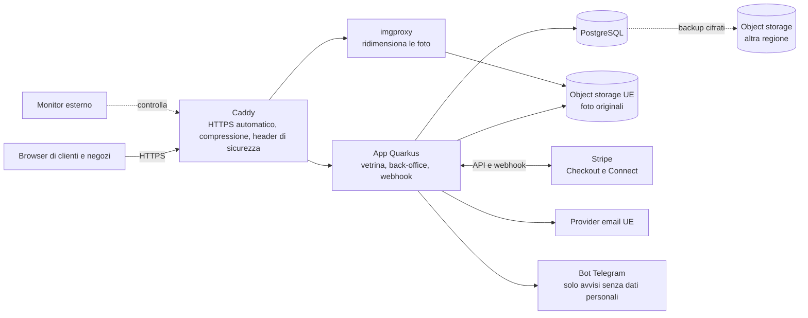
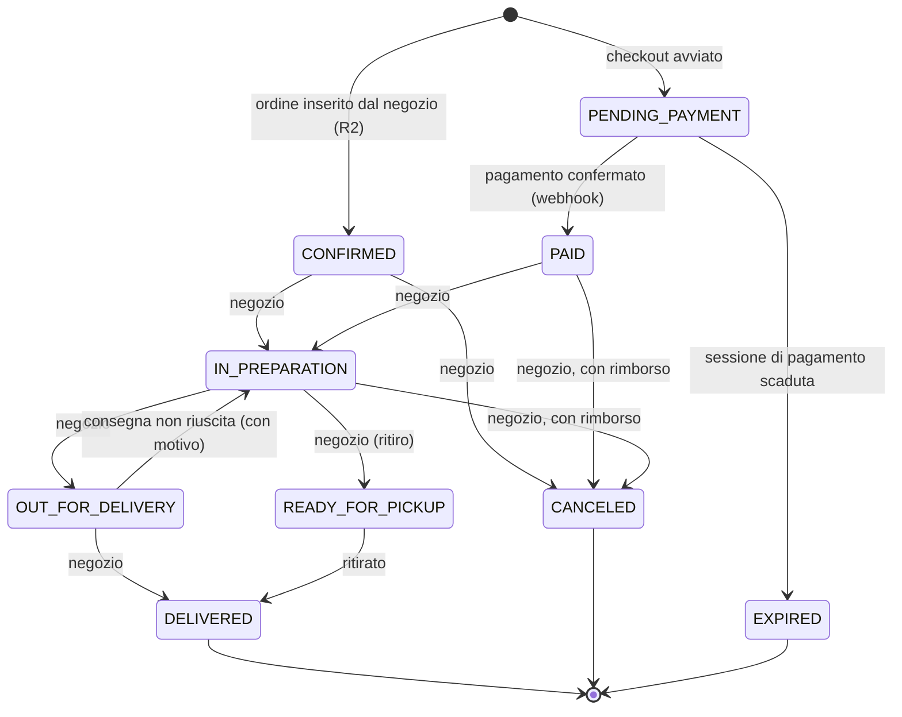

# Piattaforma per negozi locali — Documento di progetto

> **Origine:** `docs/PROGETTO.md` di Gerio, versione 0.3 del 24/9/2026, invariata fino al 4/10/2026. Tolte solo le parti personali e di business (vedi «Note del laboratorio» in fondo).
> **Nome e dominio della piattaforma:** da decidere. Nel documento uso i segnaposto `NOME-PIATTAFORMA` e `piattaforma.it`.

---

## In breve

- **Cosa:** una piattaforma unica (multi-negozio) che dà a ogni attività locale sito, shop e gestione di ordini e consegne. Si vende in abbonamento.
- **Primo caso d'uso:** una fioraia. Le date di R1 sono superate: l'obiettivo del laboratorio è in `docs/lab/traguardi.json`.
- **Tutti gli ordini in un posto:** da R2 il negozio inserisce anche gli ordini presi al telefono e al bancone, che entrano nello stesso calendario e nello stesso giro consegne. Un QR sul bancone raccoglie le date da ricordare, con il consenso del cliente; da R3 partono i promemoria.
- **Stack:** Java 25 e Quarkus 3.33 LTS, pagine generate dal server (Qute) con htmx, PostgreSQL, Stripe Checkout con Connect, Docker Compose su un server europeo dietro Caddy.
- **Principio guida:** costruisci ciò che ti distingue, affida a servizi specializzati ciò che è rischioso (dati delle carte, invio email, certificati HTTPS).
- **Ruoli legali:** il negozio è il venditore e il titolare dei dati; tu sei il fornitore della piattaforma e il responsabile del trattamento.

---

## Indice

0. [Come usare questo documento](#0-come-usare-questo-documento)
1. [Contesto e obiettivi](#1-contesto-e-obiettivi)
2. [Il prodotto](#2-il-prodotto)
3. [Rilasci e calendario](#3-rilasci-e-calendario)
4. [Architettura](#4-architettura)
5. [Multi-negozio (multi-tenancy)](#5-multi-negozio-multi-tenancy)
6. [Modello dati](#6-modello-dati)
7. [Ordini, calendario e capacità](#7-ordini-calendario-e-capacità)
8. [Pagamenti con Stripe](#8-pagamenti-con-stripe)
9. [Email e notifiche](#9-email-e-notifiche)
10. [Sicurezza](#10-sicurezza)
11. [Infrastruttura e deploy](#11-infrastruttura-e-deploy)
12. [Parte legale, fiscale e privacy](#12-parte-legale-fiscale-e-privacy)
13. [Requisiti non funzionali](#13-requisiti-non-funzionali)
14. [Qualità e test](#14-qualità-e-test)
15. [Criteri di go-live R1](#15-criteri-di-go-live-r1)
16. [Pilota, metriche e modello di business](#16-pilota-metriche-e-modello-di-business)
17. [Rischi, decisioni e domande aperte](#17-rischi-decisioni-e-domande-aperte)
- [Appendice A — Dati da chiedere alla fioraia](#appendice-a--dati-da-chiedere-alla-fioraia)
- [Appendice B — File di configurazione di partenza](#appendice-b--file-di-configurazione-di-partenza)
- [Appendice D — Glossario](#appendice-d--glossario)
- [Appendice E — Riferimenti](#appendice-e--riferimenti)

---

## 0. Come usare questo documento

- È la **fonte di verità** del progetto. Mettilo nel repository come `docs/PROGETTO.md`.
- Nelle sessioni di sviluppo (da solo o con un assistente AI) si lavora **per release e milestone** (sezione 3), un passo alla volta, sempre con test.
- Quando prendi una decisione, registrala nella sezione 17.2 («Decisioni»); quando nasce un dubbio, aggiungilo a 17.3 («Domande aperte»).
- **Convenzioni:**
  - codice, nomi di classi e tabelle, messaggi di commit: in inglese;
  - testi dell'interfaccia: in italiano;
  - importi: interi in centesimi di euro, mai `double`;
  - date e orari: salvati in UTC (`timestamptz`), mostrati nel fuso `Europe/Rome`; le date di consegna sono date locali (`date`).
- I punti marcati **[DA VERIFICARE]** vanno controllati sulla documentazione ufficiale o con un professionista prima della produzione.

---

## 1. Contesto e obiettivi

### 1.1 Contesto

- Idea: sito con shop e gestione di ordini e consegne per attività locali che non ce l'hanno.
- Scelta tecnica: niente WordPress o WooCommerce. Una piattaforma propria, con un solo codice per tutti i clienti.
- Primo caso d'uso: una fioraia.

### 1.2 Obiettivi

| # | Obiettivo | Come si misura | Scadenza |
|---|---|---|---|
| O1 | Fioraia online con ordini e pagamenti | Primo ordine pagato e consegnato | — (date di R1 superate) |

### 1.3 Fuori ambito (per ora)

- Marketplace unico con più negozi nello stesso sito.
- App native (il sito deve funzionare bene da telefono).
- Più lingue, account cliente, programmi fedeltà.
- Integrazione con registratori di cassa o gestionali del negozio: gli ordini presi al bancone si inseriscono a mano (R2) e lo scontrino resta alla cassa del negozio.
- Personalizzazioni di codice per un singolo cliente.
- Emissione di fatture elettroniche dalla piattaforma (le emette il negozio con i suoi strumenti).

### 1.4 Principi

1. **Un solo codice, tanti negozi.** Mai una copia del progetto per cliente.
2. **Costruisci ciò che ti distingue, affida il resto.** Tuoi: vetrina, ordini, consegne, back-office. Affidati: dati delle carte (Stripe), invio email (provider), certificati (Caddy e Let's Encrypt).
3. **Semplicità.** Un'applicazione unica ben divisa in moduli, pagine generate dal server, un solo server all'inizio.
4. **Dati in Europa, dati minimi**, privacy fin dalla progettazione.
5. **Il negozio possiede dominio, contenuti e dati** e deve poterli esportare quando vuole.
6. **Tutto automatico e ripristinabile:** deploy dalla CI, backup provati davvero.
7. **Veloce e accessibile da telefono.**

---

## 2. Il prodotto

### 2.1 Ruoli

| Ruolo | Chi | Cosa fa |
|---|---|---|
| Cliente | Chiunque, senza account | Sfoglia, ordina, paga, riceve le email |
| Titolare (`OWNER`) | La fioraia | Gestisce ordini, catalogo, consegne, impostazioni |
| Collaboratore (`STAFF`) | Commessa, fattorino | Vede, inserisce e aggiorna ordini e consegne |
| Admin piattaforma (`PLATFORM_ADMIN`) | Tu | Crea negozi, domini, collegamenti Stripe, supporto |

### 2.2 Vetrina pubblica (per ogni negozio)

**Pagine**
- **Home:** immagine principale, categorie, prodotti in evidenza, consegne in breve, contatti.
- **Catalogo** per categoria.
- **Scheda prodotto:** foto, descrizione, varianti con prezzo IVA inclusa, «consegna da X €», tempi di preparazione, nota sulla composizione di stagione, avviso sull'esclusione del recesso per i fiori freschi.
- **Carrello.**
- **Checkout in due passi:**
  1. consegna e destinatario;
  2. dati del cliente, eventuale richiesta di fattura, consensi (sezione 2.7), riepilogo e pulsante **«Ordina e paga»**, che porta a Stripe.
- **Esito:** ordine confermato, oppure pagamento annullato con possibilità di riprovare.
- **Stato ordine:** raggiungibile da un link segreto contenuto nell'email.
- **Informazioni:** Chi siamo, Consegne e zone, Contatti (mappa, orari, WhatsApp), Domande frequenti.
- **Richiesta preventivo:** matrimoni, eventi, cerimonie.
- **«Ricordami una data»** (R2): pagina raggiunta dal QR del bancone, in cui il cliente lascia email, etichetta e data (per esempio «Compleanno di Marta, 12 marzo») e sceglie i consensi. L'iscrizione vale solo dopo la conferma via email (sezione 2.7).
- **Pagine legali:** informazioni sul venditore, condizioni di vendita, privacy, cookie, dichiarazione di accessibilità (consigliata).
- **Piè di pagina su ogni pagina:** ragione sociale, sede, partita IVA, contatti, link alle pagine legali.

### 2.3 Regole del settore fiori

- **Prodotti «a fascia»:** bouquet piccolo, medio e grande a prezzo fisso, con foto indicative. Testo standard: «Composizione realizzata con fiori di stagione: può differire dalla foto mantenendo stile e valore».
- **Extra:** biglietto, vaso, cioccolatini, palloncino. Ognuno ha prezzo e aliquota IVA propri.
- **Tipi di evasione dell'ordine:**

| Tipo | Uso | Dati richiesti |
|---|---|---|
| `DELIVERY` | Consegna a domicilio | Destinatario, indirizzo, CAP, telefono del destinatario, note (citofono, piano) |
| `PICKUP` | Ritiro in negozio | Data e fascia oraria |
| `CEMETERY` | Consegna al cimitero | Cimitero (da elenco), indicazioni sulla posizione, foto di conferma facoltativa |
| `CEREMONY` | Cerimonia o funerale | Luogo (chiesa, sala del commiato), data e ora, testo del nastro. In R1 passa da richiesta di preventivo o WhatsApp |

- **Calendario:**
  - giorni e fasce di consegna (es. 9–12 e 15–19), ognuna con una capacità massima;
  - orario limite per la consegna in giornata (es. ordini entro le 12);
  - tempo minimo di preparazione per prodotto (es. corone: 1 giorno);
  - giorni di chiusura;
  - giorni di picco con regole speciali: capacità diversa, supplemento, oppure stop agli ordini.
- **Zone di consegna:** per CAP o per comune, ognuna con costo e ordine minimo. Fuori zona l'ordine online non è possibile e si mostra il pulsante WhatsApp.
- **Biglietto:** massimo 200 caratteri, stampabile.
- **Pagamento:** online solo anticipato, niente contrassegno. Gli ordini inseriti dal negozio si pagano in negozio, con bonifico o con un link di pagamento (sezione 7.6).
- **Reclami:** entro 24 ore dalla consegna, con foto. Politica da confermare con la fioraia.

### 2.4 Back-office del negozio (pensato prima per il telefono)

- **Accesso:** link via email, senza password; sessione lunga.
- **Cruscotto:** ordini di oggi e di domani, da preparare, in consegna, con problemi.
- **Ordini:** elenco con filtri (data di consegna, stato, tipo), dettaglio, cambio di stato, note interne, annullo con rimborso, stampa del biglietto.
- **Nuovo ordine dal telefono o dal bancone** (R2): modulo rapido, pensato per il telefono, con cliente (nome e telefono; email facoltativa), tipo di evasione, data e fascia, destinatario, biglietto, prodotti dal catalogo o voce libera con prezzo e IVA, costo di consegna e pagamento (già pagato, da incassare o link di pagamento). L'ordine entra nello stesso calendario, occupa un posto nella fascia e compare nel giro consegne con il canale indicato (sezione 7.6).
- **Giro consegne:** elenco del giorno ordinato per fascia e zona, stampabile, con link alla mappa.
- **Catalogo:** categorie, prodotti, varianti, foto, extra, attiva/disattiva.
- **Consegne:** zone, fasce e capacità, chiusure, orario limite, elenco di cimiteri e luoghi.
- **Negozio:** dati legali, orari, contatti, logo, colori, testi delle pagine.
- **Preventivi:** richieste ricevute e relativo stato.
- **Export:** CSV mensile per il commercialista.
- **Materiali per il bancone** (R2): PDF da stampare con i QR «Ricordami una data» e «Ordina online», per il cartello sul bancone e per i bigliettini da mettere negli acquisti.
- **Utenti:** invito dei collaboratori.

### 2.5 Notifiche

| Evento | Al cliente | Al negozio | Release |
|---|---|---|---|
| Ordine pagato | Email di conferma completa, con PDF delle condizioni di vendita | Email, più Telegram facoltativo | R1 |
| Richiesta di preventivo | Email di ricevuta | Email | R1 (SHOULD) |
| Ordine annullato o rimborsato | Email | — | R2 |
| Consegnato | Email, con foto se è una consegna al cimitero | — | R2 |
| Ordine inserito dal negozio | Email di conferma, se il cliente ha lasciato l'email (sezione 9.2) | — | R2 |
| Iscrizione dal QR del bancone | Email con il pulsante di conferma (doppio opt-in) | — | R2 |
| Ordini di domani, ogni sera alle 20 | — | Email con il giro consegne in PDF, utile anche se il sito non fosse raggiungibile | R2 |
| Ricorrenza tra 7 giorni | Email di promemoria (sezione 2.7) | — | R3 |

### 2.6 Area admin della piattaforma

- **Negozi:** creazione, sospensione, dati, domini, link di collegamento a Stripe, stato del collegamento.
- **Utenti e inviti.** Accesso «come negozio» per il supporto, sempre registrato nel log di audit.
- **Stato del sistema:** coda delle email, eventi Stripe ricevuti, errori.

### 2.7 Consensi e promemoria

Servono per poter scrivere ai clienti in modo lecito quando arriveranno email e automazioni (piano beta, non incluso nel laboratorio). Si raccolgono dal primo ordine. Nell'alpha l'unico invio è il promemoria della ricorrenza (da R3): nessuna email di marketing.

| Consenso | Testo nel checkout (bozza) | Casella | A cosa servirà |
|---|---|---|---|
| Opposizione al soft spam | «Potremo scriverti per proporti prodotti simili a quelli che hai acquistato. Puoi opporti ora o in qualsiasi momento.» con la casella «Non voglio ricevere queste comunicazioni» | Non selezionata | Email su prodotti simili ai clienti che non si sono opposti (art. 130, comma 4, Codice privacy) |
| Newsletter e promozioni | «Voglio ricevere novità e promozioni» | Non selezionata | Campagne a chi ha dato il consenso |
| Promemoria della ricorrenza | «Ricordami questa data l'anno prossimo», con un'etichetta facoltativa (es. «Anniversario») | Non selezionata | Un'email 7 giorni prima della stessa data, l'anno dopo (invio da R3) |

**Regole:**
- caselle mai preselezionate e indipendenti tra loro; l'ordine si completa anche senza selezionarne nessuna;
- per ogni ordine si registra una riga per finalità, con la scelta, la versione del testo, la data e l'email (tabella `consent_record`, sezione 6);
- l'email di conferma ripete l'avviso sul soft spam e spiega come opporsi (sezione 9.2);
- il negozio vede i consensi nel dettaglio dell'ordine, ma non può modificarli;
- i testi definitivi vanno approvati prima del go-live (Appendice A).

**Da dove arrivano i consensi:**

| Canale | Release | Come |
|---|---|---|
| Checkout online | R1 | Le tre caselle della tabella sopra |
| Link nell'email di conferma di un ordine inserito dal negozio | R2 | Pagina con le stesse scelte e un pulsante «Salva». Il negozio non spunta mai i consensi al posto del cliente |
| QR del bancone, pagina «Ricordami una data» | R2 | Email, etichetta, giorno e mese, newsletter facoltativa. Valgono solo dopo la conferma: l'email contiene un link a una pagina con il pulsante «Conferma» (POST), come per il login, così gli antivirus delle email non confermano da soli |

**Per gli ordini inseriti dal negozio niente soft spam automatico:** l'avviso non è stato dato quando il cliente ha lasciato l'email, quindi per scrivergli serve una sua scelta dal link. **[DA VERIFICARE con il consulente se l'avviso nell'email di conferma può bastare]**

**Promemoria della ricorrenza (R3):**
- un job ogni mattina alle 9 cerca le date che cadono tra 7 giorni e accoda un'email semplice («Tra una settimana è…»), con il link al negozio e il pulsante per non ricevere più promemoria;
- ogni consenso produce **un solo invio** (tabella `reminder_dispatch`, sezione 6). Nell'email c'è il pulsante «Ricordamelo anche l'anno prossimo», che registra un nuovo consenso: così si resta dentro ciò che il cliente ha chiesto;
- chi ha revocato non riceve nulla, anche se ha più date salvate;
- il 29 febbraio, negli anni non bisestili, vale il 28;
- dal piano beta (B4) il promemoria passa al motore delle automazioni.

---

## 3. Rilasci e calendario

Il calendario parte da mercoledì 23 settembre 2026. Le stime assumono 10–15 ore di lavoro a settimana.

| Release | Periodo | Obiettivo | Date chiave |
|---|---|---|---|
| **R0 Fondamenta** | 23 set – 4 ott | Infrastruttura e scheletro | — |
| **R1 Ognissanti** | 5 – 25 ott | Fioraia online con ordini e pagamenti | Go-live domenica 25 ottobre; picco 30 ottobre – 2 novembre |
| **R2 Natale** | 3 nov – 13 dic | Tutti gli ordini nel back-office (anche telefono e bancone), QR sul bancone, export | Natale venerdì 25 dicembre |
| **R3 San Valentino** | 7 gen – 7 feb 2027 | Multi-negozio completo, promemoria delle ricorrenze e 2 piloti esterni | San Valentino domenica 14 febbraio |
| **R4 Primavera** | feb – mag 2027 | Promozioni, abbonamenti, aggiornamento LTS | 8 marzo (lunedì), Festa della mamma domenica 9 maggio |

### R0 — Fondamenta (23 settembre – 4 ottobre)

- Nome della piattaforma scelto e dominio registrato.
- Repository, progetto Quarkus, CI con build e test, immagine Docker.
- Server, Caddy, PostgreSQL, bucket per le foto con imgproxy; deploy automatico di una pagina di prova sul dominio.
- Account Stripe della piattaforma in modalità test con Connect attivo; account della fioraia creato e collegato (prima in test).
- Provider email configurato, con SPF, DKIM e DMARC sul dominio della piattaforma.
- Backup notturno, monitoraggio della disponibilità, raccolta degli errori.

**Fatto quando:** un push su `main` arriva in produzione da solo, e il ripristino di un backup è stato provato almeno una volta.

### R1 — Ognissanti (5 – 25 ottobre): ambito minimo

**Indispensabile (MUST)**
- Modello multi-negozio già pronto, con un solo negozio attivo e riconoscimento dal dominio.
- Vetrina: home, catalogo, prodotto, carrello, checkout, esito, stato ordine, pagine informative e legali.
- Regole di consegna: zone, fasce con capacità, orario limite, chiusure, tempi di preparazione. Tipi `DELIVERY`, `PICKUP`, `CEMETERY`.
- Pagamento con Stripe Checkout (addebito diretto sull'account della fioraia) e webhook idempotenti.
- Email di conferma con tutte le informazioni obbligatorie; avviso al negozio.
- Consensi al checkout (sezione 2.7), registrati in `consent_record`.
- Back-office minimo: accesso via email, ordini (elenco, dettaglio, cambio di stato), giro consegne stampabile, stampa del biglietto.
- Catalogo: gestione essenziale (testo, prezzo, foto, attivo), oppure import da CSV se il tempo stringe.
- SEO di base, partita IVA nel piè di pagina, solo cookie tecnici.

**Utile (SHOULD):** notifica Telegram, richiesta di preventivo, domande frequenti, link «Non voglio ricevere comunicazioni» nell'email di conferma (pagina con un pulsante, come per il login).

**Non in R1 (WON'T):** rimborsi dal back-office (si fanno dalla dashboard Stripe), upload automatico della foto di consegna, promozioni, più utenti per negozio.

**Piano settimanale**

| Settimana | Lavoro |
|---|---|
| 5 – 11 ottobre | Modello dati, catalogo, pagine della vetrina |
| 12 – 18 ottobre | Carrello, checkout, calendario consegne, Stripe e webhook, email |
| 19 – 25 ottobre | Back-office minimo, pagine legali, test end-to-end, ordini di prova reali, go-live |

**Piano B** se il 18 ottobre sei in ritardo: vetrina e checkout vanno online comunque; gli ordini si gestiscono con le email e la dashboard Stripe, e il back-office slitta a R2.

### R2 — Natale (3 novembre – 13 dicembre)

**Indispensabile (MUST)**
- Ordini inseriti dal negozio, dal telefono e dal bancone (sezioni 2.4 e 7.6), con conferma al cliente (9.2).
- Pagina «Ricordami una data» con doppio opt-in, link per i consensi nell'email degli ordini inseriti dal negozio, materiali per il bancone in PDF (sezione 2.7).
- Email serale al negozio con gli ordini di domani (9.3). Ora la piattaforma è il quaderno degli ordini: una copia deve arrivare anche se il sito non risponde.
- Catalogo completo con varianti ed extra, gestione delle foto.
- Calendario avanzato: giorni di picco, capacità per singola data, supplementi.
- Export CSV per il commercialista e archivio mensile.
- Backup con ripristino a un punto preciso nel tempo (archiviazione WAL).
- Correzioni in base a quanto emerso a Ognissanti.

**Utile (SHOULD):** statistiche di visita senza cookie e Google Search Console (servono al caso studio); foto di consegna caricata dal telefono, con email al cliente; annullo e rimborso dal back-office tramite l'API di Stripe; link di pagamento per gli ordini al telefono (7.6).

**Spostata in R3:** anonimizzazione automatica dei dati di consegna vecchi. I primi dati compiono 12 mesi solo a fine ottobre 2027.

Le aggiunte della versione 0.3 valgono circa 20 ore: per farle stare, alcune voci sono passate tra le SHOULD.

**Fatto quando:** un ordine preso al telefono si inserisce dal telefono in meno di un minuto e compare nel giro consegne; un'iscrizione dal QR è stata confermata da un telefono vero; l'email serale arriva; il ripristino a un punto preciso nel tempo è stato provato.

### R3 — San Valentino (7 gennaio – 7 febbraio 2027)

- Promemoria delle ricorrenze, invio semplice 7 giorni prima (sezione 2.7). Va fatto per primo: le date raccolte a Natale cominciano a cadere a gennaio.
- Inserimento di un nuovo negozio: creazione, collegamento Stripe in autonomia, dominio personalizzato con certificato automatico.
- Temi (colori, font, logo) e testi personalizzabili; modelli di pagine legali per ogni negozio.
- Collaboratori (`STAFF`) e ruoli.
- Contratti: condizioni del servizio e accordo sul trattamento dei dati (DPA).
- Abbonamenti dei negozi con Stripe Billing; fattura elettronica emessa con un programma collegato allo SDI.
- Anonimizzazione automatica dei dati di consegna vecchi (spostata da R2).
- Ambiente di staging separato; test di carico prima del 14 febbraio.
- Due piloti esterni online.

**Se il tempo non basta:** un solo tema con colori e logo; staging sullo stesso server; anonimizzazione rimandata, ma pronta entro settembre 2027.

**Fatto quando:** i due piloti esterni sono online; un promemoria di prova è arrivato 7 giorni prima della data; l'abbonamento di un negozio è stato addebitato e fatturato.

### R4 — Primavera (febbraio – maggio 2027)

- Promozioni conformi alla regola del prezzo più basso degli ultimi 30 giorni (sezione 12).
- Adattamento ad altri settori: negozi senza consegna a domicilio, prenotazioni semplici.
- Aggiornamento alla prossima LTS di Quarkus: la 3.33 è supportata fino al 25 marzo 2027 e la successiva prevista è la 4.3, a fine febbraio 2027. È un salto di versione maggiore: pianificalo per tempo. **[DA VERIFICARE]**
- Dichiarazione di accessibilità e verifica WCAG completa.

---

## 4. Architettura

### 4.1 Vista d'insieme



È un'unica applicazione divisa in moduli (monolite modulare), con un solo pacchetto da installare. Niente microservizi.

### 4.2 Scelte tecnologiche

| Area | Scelta | Perché | Alternativa |
|---|---|---|---|
| Linguaggio | Java 25 (LTS) | Lo conosci, supporto lungo | Java 21 |
| Framework | Quarkus 3.33 LTS | API Jakarta EE che conosci (CDI, REST, JPA), ricarica a caldo, Dev Services che avviano PostgreSQL da soli, supporto completo a Java 25; LTS supportata fino al 25 marzo 2027 | Jakarta EE su WildFly o Payara (sviluppo più lento) |
| Persistenza | Hibernate ORM con Panache, Flyway per le migrazioni | Standard; multi-negozio con discriminatore già supportato | jOOQ |
| Database | PostgreSQL 17 | Solido, JSONB, lock consultivi | PostgreSQL 18 |
| Pagine | Qute (template lato server, controllati in compilazione, escaping HTML automatico) con htmx 2 | Niente single-page app, SEO migliore, front-end minimo | JSF (sconsigliato per siti pubblici) |
| CSS | Tailwind CSS v4 con CLI standalone (senza Node) | Gli assistenti AI generano ottimo markup Tailwind; tema con variabili CSS | Bootstrap 5 (nessuna build) |
| Pagamenti | Stripe Checkout con Connect (addebiti diretti) | I dati delle carte non passano dal tuo server; ogni negozio incassa sul suo conto | — |
| Email | Provider transazionale UE via SMTP (estensione Mailer di Quarkus) | Consegna affidabile, nessun server di posta da gestire | — |
| Immagini | Object storage compatibile S3 in UE, con imgproxy | Ridimensionamento e WebP/AVIF al volo, rimozione dei metadati | Varianti generate al caricamento |
| Reverse proxy | Caddy 2 | HTTPS automatico anche per i domini dei clienti (on-demand TLS) | Traefik |
| Container | Docker con Docker Compose | Semplice su un solo server | Kubernetes (eccessivo) |
| CI/CD | GitHub Actions e GitHub Container Registry | Tutto in un posto | GitLab CI |
| Errori | Sentry con dati in UE (estensione `quarkus-logging-sentry`), oppure GlitchTip self-hosted | Avvisi immediati sugli errori | — |
| Statistiche | Plausible o Umami, senza cookie | Nessun banner cookie necessario | — |

**[DA VERIFICARE all'avvio]** ultima patch della 3.33 LTS (il 22 settembre 2026 era la 3.33.3.3, e la 3.33 era la LTS più recente), compatibilità delle estensioni scelte, regione dati UE dei fornitori.

### 4.3 Struttura del codice (package per funzionalità)

```
src/main/java/it/<nome>/platform/
  tenant/         Tenant, TenantDomain, TenantResolver, TenantContext
  identity/       User, Membership, MagicLinkService, SessionService
  catalog/        Category, Product, ProductVariant, Addon, PriceHistory, ProductImage
  delivery/       DeliveryZone, DeliverySlot, CalendarException, Place, AvailabilityService
  cart/           Cart, CartItem, CartService
  ordering/       CustomerOrder, OrderItem, OrderEvent, OrderStateMachine, CheckoutService, OrderNumberService,
                  ManualOrderService (R2)
  payments/       StripeClientProvider, CheckoutSessionFactory, StripeWebhookResource, ConnectOnboardingService
  notifications/  OutboxMessage, OutboxWorker, EmailSender, TelegramNotifier
  consent/        ConsentRecord, ConsentService; ConsentRequest (R2); ReminderJob (R3)
  storefront/     risorse web e template pubblici
  backoffice/     risorse web e template del negozio
  platformadmin/  risorse web e template dell'admin
  legal/          LegalDocument, pagine e PDF legali
  seo/            sitemap, robots, dati strutturati JSON-LD
  export/         CSV per il commercialista
  common/         Money, Clock, errori, validazione
src/main/resources/
  templates/      storefront/, backoffice/, email/, legal/
  db/migration/   V1__init.sql, V2__...
  web/            sorgente CSS, htmx, immagini statiche
```

**Regole**
- I moduli si parlano tramite servizi, non usando direttamente le entità degli altri moduli.
- Nessuna logica di business nei template o nelle risorse REST.
- Un `Clock` iniettato ovunque serva l'ora, così i test su orario limite e fasce sono ripetibili.

### 4.4 Pagine e interfaccia

- Tutte le pagine sono generate dal server. htmx serve per aggiornare il carrello, mostrare le fasce disponibili quando si sceglie la data e cambiare lo stato di un ordine nel back-office.
- **Miglioramento progressivo:** acquisto e cambio di stato funzionano anche senza JavaScript, con form classici.
- **Mobile first.** Obiettivo di accessibilità WCAG 2.1 livello AA: etichette sui campi, contrasto, focus visibile, uso completo da tastiera.
- **Tema per negozio:** variabili CSS (`--color-primary`, font), logo e immagine principale. Un tema base in R1, 2–3 temi in R3.
- **Nessuna risorsa caricata da CDN esterne** (font compresi): più privacy e nessun trasferimento di dati a terzi.

### 4.5 Immagini

- **Caricamento:** controllo del tipo reale del file, non solo dell'estensione; massimo 10 MB; JPEG, PNG o WebP.
- **Archiviazione:** originali in un bucket privato, con nomi casuali.
- **Pubblicazione tramite imgproxy:** URL firmati e misure predefinite (miniatura 400 px, scheda 800 px, grande 1600 px), formato WebP o AVIF, metadati EXIF rimossi (le foto fatte col telefono contengono la posizione GPS).
- Cache lunga su Caddy. Testo alternativo obbligatorio per ogni foto.

---

## 5. Multi-negozio (multi-tenancy)

### 5.1 Strategia

- Un solo database e un solo schema, con una colonna `tenant_id` su ogni tabella che appartiene a un negozio.
- Hibernate ORM con strategia a discriminatore. In Quarkus si attiva con `quarkus.hibernate-orm.multitenant=DISCRIMINATOR`: le entità con un campo annotato `@TenantId` vengono valorizzate e filtrate automaticamente nelle query.
- Un bean `TenantResolver` (annotato `@PersistenceUnitExtension` e `@RequestScoped`) restituisce il negozio della richiesta corrente.
- **Attenzione al tipo:** il `TenantResolver` restituisce una `String`, quindi `tenant_id` deve essere di tipo testo (per esempio un UUID in forma testuale). Con un id numerico i filtri di Hibernate danno errori di tipo: è un problema noto.
- Tabelle globali, senza `@TenantId`: `tenant`, `tenant_domain`, `app_user`, `membership`, `login_token`, `user_session`, `stripe_event`. Anche `outbox_message` e `audit_log` sono globali: hanno una colonna `tenant_id` normale, valorizzata a mano, perché si scrivono anche fuori dal contesto di un negozio.

### 5.2 Come si riconosce il negozio

1. Caddy inoltra l'header `Host` originale.
2. Un filtro legge l'host, lo normalizza (minuscole, senza porta, senza `www.`) e lo cerca in `tenant_domain`, con una cache in memoria di pochi minuti.
3. Se l'host è il dominio della piattaforma (`piattaforma.it`), la richiesta va alla landing o all'area admin. Se è `negozio.piattaforma.it` o un dominio personalizzato, va alla vetrina di quel negozio.
4. Host sconosciuto → 404 generico. Negozio sospeso → pagina «temporaneamente non disponibile».
5. Il filtro mette nel `TenantContext` (legato alla richiesta) id, impostazioni e fuso orario del negozio. Per il dominio della piattaforma (landing, area admin, webhook) mette invece un valore riservato, per esempio `__platform__`, che non corrisponde a nessun negozio: le tabelle globali funzionano, quelle dei negozi risultano vuote.

**Webhook, job pianificati e coda delle email:** il negozio va impostato esplicitamente nel `TenantContext` prima di toccare le sue tabelle. Per i webhook si ricava dall'id dell'account Stripe; nei job serve un contesto di richiesta attivo (`@ActivateRequestContext`). Se il `TenantContext` è vuoto, il resolver lancia un'eccezione: mai procedere con un negozio indefinito.

**Attenzione:** Hibernate fissa il negozio quando apre la sessione, cioè in pratica all'inizio della transazione. Imposta il `TenantContext` prima di aprirla. Se nella stessa richiesta hai già usato il database (per esempio per registrare l'evento Stripe), elabora i dati del negozio in una nuova transazione (`@Transactional(REQUIRES_NEW)` su un altro bean). Copri questo caso con un test. **[DA VERIFICARE]**

**Area admin:** lavora su un negozio alla volta, impostando il `TenantContext` dal percorso (es. `/admin/negozi/{id}/...`) e registrando ogni accesso nel log di audit.

### 5.3 Isolamento: difese e test

- **Test automatici obbligatori:** si creano due negozi con dati propri e si verifica, per ogni endpoint e ogni repository, che il negozio A non possa vedere né modificare nulla del negozio B, anche mettendo nell'URL gli id del B.
- Ogni accesso per id nel back-office controlla anche l'appartenenza al negozio (seconda barriera).
- Le rare operazioni che riguardano più negozi insieme (solo admin della piattaforma, es. statistiche) passano da un servizio dedicato con SQL nativo, perché le query Hibernate sono sempre filtrate per negozio; ogni uso è registrato nel log di audit.
- Da R3 in poi: Row Level Security di PostgreSQL come ulteriore barriera.

### 5.4 Domini

- **Sottodominio gratuito:** `slug.piattaforma.it`.
- **Dominio personalizzato:** intestato al negozio. Il negozio (o tu per suo conto) punta i DNS al server: record A/AAAA, oppure CNAME per sottodomini come `www`.
- **Certificati:** Caddy li ottiene alla prima visita (on-demand TLS), dopo aver chiesto il permesso all'app tramite un endpoint interno (sezione 11.4).

---

## 6. Modello dati

Bozza della prima migrazione Flyway (`V1__init.sql`). Convenzioni: chiavi primarie `bigint` generate dal database, `tenant_id text` sulle tabelle del negozio, importi `integer` in centesimi, aliquote IVA in punti base (`1000` = 10%), date e ore `timestamptz`.

```sql
-- ===== Tabelle globali =====
create table tenant (
  id                     text primary key,              -- UUID in forma testuale
  slug                   text not null unique,
  status                 text not null default 'ACTIVE', -- ACTIVE, SUSPENDED
  display_name           text not null,
  legal_name             text not null,
  vat_number             text,                           -- partita IVA
  tax_code               text,                           -- codice fiscale
  rea                    text,
  pec                    text,
  email                  text not null,
  phone                  text,
  address_line           text, postal_code text, city text, province text,
  timezone               text not null default 'Europe/Rome',
  stripe_account_id      text unique,
  stripe_charges_enabled boolean not null default false,
  theme                  jsonb not null default '{}',
  settings               jsonb not null default '{}',    -- orario limite, testi, social...
  created_at             timestamptz not null default now()
);

create table tenant_domain (
  id          bigint generated always as identity primary key,
  tenant_id   text not null references tenant(id),
  hostname    text not null unique,
  is_primary  boolean not null default false,
  verified_at timestamptz
);

create table app_user (
  id            bigint generated always as identity primary key,
  email         text not null unique,
  name          text,
  platform_role text,                                     -- PLATFORM_ADMIN oppure null
  created_at    timestamptz not null default now()
);

create table membership (
  user_id   bigint not null references app_user(id),
  tenant_id text   not null references tenant(id),
  role      text   not null,                              -- OWNER, STAFF
  primary key (user_id, tenant_id)
);

create table login_token (
  id         bigint generated always as identity primary key,
  user_id    bigint not null references app_user(id),
  token_hash text not null unique,                        -- SHA-256: mai il token in chiaro
  expires_at timestamptz not null,
  used_at    timestamptz
);

create table user_session (                               -- sessioni del back-office, revocabili
  id         bigint generated always as identity primary key,
  user_id    bigint not null references app_user(id),
  token_hash text not null unique,                        -- SHA-256 del valore nel cookie
  created_at timestamptz not null default now(),
  expires_at timestamptz not null,
  revoked_at timestamptz
);

-- ===== Catalogo =====
create table category (
  id        bigint generated always as identity primary key,
  tenant_id text not null references tenant(id),
  name      text not null,
  slug      text not null,
  position  int not null default 0,
  visible   boolean not null default true,
  unique (tenant_id, slug)
);

create table product (
  id                  bigint generated always as identity primary key,
  tenant_id           text not null references tenant(id),
  category_id         bigint references category(id),
  name                text not null,
  slug                text not null,
  description         text,
  vat_rate_bp         int not null,                         -- 1000 = 10%
  lead_time_days      int not null default 0,               -- giorni minimi di preparazione
  withdrawal_excluded boolean not null default true,        -- fiori freschi: recesso escluso
  allowed_fulfillment text[] not null default '{DELIVERY,PICKUP,CEMETERY}',
  active              boolean not null default true,
  position            int not null default 0,
  seo_title           text,
  seo_description     text,
  unique (tenant_id, slug)
);

create table product_variant (
  id          bigint generated always as identity primary key,
  tenant_id   text not null references tenant(id),
  product_id  bigint not null references product(id),
  name        text not null,                                -- es. "Medio"
  price_cents int not null check (price_cents >= 0),
  active      boolean not null default true,
  position    int not null default 0
);

create table price_history (                                -- per le promozioni: prezzo più basso a 30 giorni
  id          bigint generated always as identity primary key,
  tenant_id   text not null references tenant(id),
  variant_id  bigint not null references product_variant(id),
  price_cents int not null,
  valid_from  timestamptz not null
);

create table product_image (
  id          bigint generated always as identity primary key,
  tenant_id   text not null references tenant(id),
  product_id  bigint not null references product(id),
  storage_key text not null,
  alt_text    text not null,
  width       int,
  height      int,
  position    int not null default 0
);

create table addon (                                         -- extra: biglietto, vaso...
  id                  bigint generated always as identity primary key,
  tenant_id           text not null references tenant(id),
  name                text not null,
  price_cents         int not null,
  vat_rate_bp         int not null,
  withdrawal_excluded boolean not null default false,
  active              boolean not null default true
);

-- ===== Consegne =====
create table delivery_zone (
  id              bigint generated always as identity primary key,
  tenant_id       text not null references tenant(id),
  name            text not null,
  postal_codes    text[] not null default '{}',
  municipalities  text[] not null default '{}',
  fee_cents       int not null,
  min_order_cents int not null default 0,
  active          boolean not null default true
);

create table delivery_slot (                                 -- fasce settimanali ricorrenti
  id                bigint generated always as identity primary key,
  tenant_id         text not null references tenant(id),
  weekday           smallint not null check (weekday between 1 and 7), -- 1 = lunedì
  start_time        time not null,
  end_time          time not null,
  capacity          int not null,
  fulfillment_types text[] not null default '{DELIVERY,CEMETERY}',
  active            boolean not null default true
);

create table calendar_exception (
  id              bigint generated always as identity primary key,
  tenant_id       text not null references tenant(id),
  day             date not null,
  kind            text not null,                             -- CLOSED, CAPACITY, PEAK
  capacity_factor numeric(4,2),                              -- es. 1.50 nei giorni di picco
  surcharge_cents int,
  note            text,
  unique (tenant_id, day, kind)
);

create table place (                                         -- cimiteri, chiese, sale del commiato
  id        bigint generated always as identity primary key,
  tenant_id text not null references tenant(id),
  kind      text not null,                                   -- CEMETERY, CHURCH, FUNERAL_HOME
  name      text not null,
  address   text,
  zone_id   bigint references delivery_zone(id),
  active    boolean not null default true
);

-- ===== Carrello (cookie tecnico con id casuale) =====
create table cart (
  id         text primary key,                               -- token casuale
  tenant_id  text not null references tenant(id),
  updated_at timestamptz not null default now()
);

create table cart_item (
  id         bigint generated always as identity primary key,
  tenant_id  text not null references tenant(id),
  cart_id    text not null references cart(id) on delete cascade,
  variant_id bigint references product_variant(id),
  addon_id   bigint references addon(id),
  quantity   int not null check (quantity > 0)
);

-- ===== Ordini =====
create table customer_order (
  id                         bigint generated always as identity primary key,
  tenant_id                  text not null references tenant(id),
  number                     text not null,                  -- es. 2026-0001, per negozio
  public_token               text not null unique,           -- link segreto alla pagina di stato
  status                     text not null,                  -- vedi sezione 7.1
  fulfillment_type           text not null,
  customer_name              text not null,
  customer_email             text not null,
  customer_phone             text,
  recipient_name             text,
  recipient_phone            text,
  address_line               text, postal_code text, city text,
  delivery_notes             text,
  zone_id                    bigint references delivery_zone(id),
  place_id                   bigint references place(id),
  place_details              text,                           -- es. posizione nel cimitero
  delivery_date              date not null,
  slot_id                    bigint references delivery_slot(id),
  slot_start                 time,
  slot_end                   time,
  card_message               text check (char_length(card_message) <= 200),
  customer_notes             text,
  subtotal_cents             int not null,
  delivery_fee_cents         int not null,
  surcharge_cents            int not null default 0,
  total_cents                int not null,
  refunded_cents             int not null default 0,
  vat_breakdown              jsonb not null,                 -- imponibile e imposta per aliquota
  invoice_requested          boolean not null default false,
  billing                    jsonb,                          -- nome o ragione sociale, CF, P.IVA, codice SDI o PEC
  terms_version              text not null,                  -- versione delle condizioni accettate
  hold_expires_at            timestamptz,                    -- blocco del posto durante il pagamento
  stripe_checkout_session_id text unique,
  stripe_payment_intent_id   text,
  paid_at                    timestamptz,
  delivered_at               timestamptz,
  delivery_photo_key         text,
  over_capacity              boolean not null default false,
  internal_notes             text,
  anonymized_at              timestamptz,
  created_at                 timestamptz not null default now(),
  updated_at                 timestamptz not null default now(),
  unique (tenant_id, number)
);
create index customer_order_day_idx on customer_order (tenant_id, delivery_date, status);

create table order_item (
  id               bigint generated always as identity primary key,
  tenant_id        text not null references tenant(id),
  order_id         bigint not null references customer_order(id),
  product_id       bigint,
  variant_id       bigint,
  addon_id         bigint,
  name_snapshot    text not null,                            -- nome e variante al momento dell'ordine
  unit_price_cents int not null,
  quantity         int not null,
  vat_rate_bp      int not null,
  line_total_cents int not null
);

create table order_event (                                    -- storico dei cambi di stato
  id            bigint generated always as identity primary key,
  tenant_id     text not null references tenant(id),
  order_id      bigint not null references customer_order(id),
  from_status   text,
  to_status     text not null,
  actor_user_id bigint references app_user(id),               -- null se automatico (webhook, job)
  note          text,
  at            timestamptz not null default now()
);

create table consent_record (                                 -- consensi raccolti al checkout (sezione 2.7)
  id           bigint generated always as identity primary key,
  tenant_id    text not null references tenant(id),
  order_id     bigint not null references customer_order(id),
  email        text not null,
  purpose      text not null,                                 -- SOFT_SPAM, MARKETING_EMAIL, OCCASION_REMINDER
  granted      boolean not null,                              -- per SOFT_SPAM: false = il cliente si è opposto
  text_version text not null,                                 -- versione del testo mostrato
  details      jsonb,                                         -- es. {"label":"Anniversario","month":11,"day":2}
  at           timestamptz not null default now()
);

create table tenant_counter (                                  -- numerazione ordini per negozio e anno
  tenant_id text not null references tenant(id),
  name      text not null,
  year      int  not null,
  value     int  not null,
  primary key (tenant_id, name, year)
);

-- ===== Integrazioni e servizi interni =====
create table stripe_event (                                    -- idempotenza dei webhook
  id           text primary key,                               -- id dell'evento Stripe
  type         text not null,
  account      text,
  received_at  timestamptz not null default now(),
  processed_at timestamptz
);

create table outbox_message (                                  -- email e notifiche con ritentativi
  id              bigint generated always as identity primary key,
  tenant_id       text references tenant(id),
  channel         text not null,                               -- EMAIL, TELEGRAM
  payload         jsonb not null,
  status          text not null default 'PENDING',             -- PENDING, SENT, FAILED
  attempts        int not null default 0,
  next_attempt_at timestamptz not null default now(),
  last_error      text
);

create table audit_log (
  id        bigint generated always as identity primary key,
  tenant_id text,
  user_id   bigint,
  action    text not null,
  entity    text,
  entity_id text,
  details   jsonb,
  at        timestamptz not null default now()
);

create table quote_request (
  id         bigint generated always as identity primary key,
  tenant_id  text not null references tenant(id),
  kind       text not null,                                    -- WEDDING, EVENT, CEREMONY, OTHER
  name       text not null,
  email      text not null,
  phone      text,
  event_date date,
  message    text not null,
  status     text not null default 'NEW',
  created_at timestamptz not null default now()
);

create table legal_document (                                   -- testi legali versionati per negozio
  id              bigint generated always as identity primary key,
  tenant_id       text not null references tenant(id),
  kind            text not null,                               -- TERMS, PRIVACY, COOKIES, IMPRINT, ACCESSIBILITY
  version         text not null,
  content_md      text not null,
  pdf_storage_key text,
  published_at    timestamptz,
  unique (tenant_id, kind, version)
);
```

**Da aggiungere in R3:** tabella degli abbonamenti dei negozi (`stripe_customer_id`, `stripe_subscription_id`, piano, stato) e degli inviti ai collaboratori.

**Migrazioni successive** (bozza):

```sql
-- ===== V2 (R2): ordini inseriti dal negozio, consensi dal QR e dal link =====
alter table customer_order
  add column channel        text not null default 'ONLINE', -- ONLINE, PHONE, COUNTER
  add column payment_method text,                           -- ordini del negozio: CASH, POS, BANK_TRANSFER, PAYMENT_LINK, OTHER
  add column created_by     bigint references app_user(id), -- chi ha inserito l'ordine
  alter column customer_email drop not null,                -- al bancone l'email è facoltativa
  alter column terms_version drop not null;                 -- al bancone non ci sono condizioni da accettare
alter table customer_order add constraint customer_order_online_chk
  check (channel <> 'ONLINE' or (customer_email is not null and terms_version is not null));

alter table consent_record
  alter column order_id drop not null,                      -- null per le iscrizioni dal QR
  add column source text not null default 'CHECKOUT';       -- CHECKOUT, ORDER_EMAIL_LINK, COUNTER_QR, REMINDER_EMAIL, UNSUBSCRIBE_LINK

create table consent_request (                              -- iscrizioni dal QR in attesa di conferma (doppio opt-in)
  id           bigint generated always as identity primary key,
  tenant_id    text not null references tenant(id),
  email        text not null,
  token_hash   text not null unique,                        -- SHA-256 del token nel link di conferma
  choices      jsonb not null,                              -- finalità, etichetta, giorno e mese, versione del testo
  expires_at   timestamptz not null,                        -- 48 ore dopo la richiesta
  confirmed_at timestamptz
);

-- ===== V3 (R3): promemoria delle ricorrenze =====
create table reminder_dispatch (                            -- un solo invio per ogni consenso
  id                bigint generated always as identity primary key,
  tenant_id         text not null references tenant(id),
  consent_record_id bigint not null unique references consent_record(id),
  remind_date       date not null,                          -- data della ricorrenza ricordata
  sent_at           timestamptz not null default now()
);
```

- Per gli ordini inseriti dal negozio `paid_at` resta il segno del pagamento: vuoto vuol dire «da incassare».
- Come per gli altri consensi, una revoca non cancella nulla: si aggiunge una riga con `granted = false`.

---

## 7. Ordini, calendario e capacità

### 7.1 Stati dell'ordine



**Regole**
- Le transizioni passano solo dalla `OrderStateMachine` e ogni transizione scrive un `order_event`.
- `CANCELED` richiede un motivo. In R1 il rimborso si fa dalla dashboard Stripe e si registra nel back-office; in R2 parte in automatico via API.
- I rimborsi parziali (per esempio un extra non disponibile) aggiornano `refunded_cents` senza cambiare stato.
- Non si torna indietro di stato, tranne «consegna non riuscita», che va motivata.
- Gli ordini inseriti dal negozio partono da `CONFIRMED` e poi seguono lo stesso percorso; il pagamento non cambia lo stato (sezione 7.6).

### 7.2 Numerazione e link

- Numero d'ordine per negozio e anno, nel formato `AAAA-NNNN`: si ottiene con `update tenant_counter set value = value + 1 ... returning value` nella stessa transazione che crea l'ordine.
- `public_token`: almeno 128 bit casuali, sicuro negli URL. Serve per la pagina di stato. Mai mostrare ai clienti l'id interno.

### 7.3 Disponibilità di date e fasce

Una data D si può scegliere, per un carrello C e un tipo di evasione T, se:
1. D non è segnata come `CLOSED` e il negozio lavora in quel giorno della settimana;
2. D è almeno oggi più il tempo di preparazione massimo tra i prodotti di C;
3. se D è oggi, l'ora attuale nel fuso `Europe/Rome` è prima dell'orario limite del negozio;
4. esiste almeno una fascia attiva, per quel giorno e per il tipo T, con posti liberi.

**Posti liberi di una fascia** = capacità × fattore del giorno − ordini già pagati o confermati dal negozio (e successivi) in quella fascia − ordini `PENDING_PAYMENT` con blocco ancora valido.

- Per `DELIVERY`: CAP o comune devono appartenere a una zona attiva; si applicano costo della zona, ordine minimo ed eventuale supplemento del giorno di picco.
- Per `PICKUP`: si usano gli orari di apertura come fasce di ritiro, senza limite di capacità o con un limite alto.

### 7.4 Concorrenza ed eccesso di prenotazioni

- **Prima di andare su Stripe**, in una transazione: `pg_advisory_xact_lock` sulla combinazione negozio, data e fascia (chiave numerica ottenuta con un hash dei tre valori); ricalcolo dei posti; inserimento dell'ordine `PENDING_PAYMENT` con `hold_expires_at` = ora + 35 minuti.
- La sessione Stripe scade dopo 30 minuti (`expires_at`, il minimo consentito): il blocco dura un po' più della sessione.
- **Se il pagamento arriva dopo la scadenza del blocco e la fascia è piena:** l'ordine si accetta comunque (il cliente ha già pagato), si imposta `over_capacity = true` e si avvisa il negozio, che decide se spostare la fascia o annullare con rimborso.
- Prezzi, costi di consegna e totali si calcolano sempre sul server: il browser non invia mai prezzi.

### 7.5 Checkout passo per passo

1. Il cliente sceglie il tipo di evasione; con htmx la pagina mostra le date disponibili e poi le fasce.
2. Inserisce destinatario, messaggio del biglietto e i suoi dati; se vuole la fattura, aggiunge i dati fiscali (privati: codice fiscale; aziende: ragione sociale, partita IVA, codice SDI o PEC).
3. Vede il riepilogo con prezzi IVA inclusa, costo di consegna, totale e link alle condizioni di vendita, poi preme «Ordina e paga».
4. Il server valida tutto, crea l'ordine `PENDING_PAYMENT`, crea la sessione Stripe e reindirizza.
5. Al ritorno da Stripe, la pagina di esito mostra «stiamo confermando il pagamento» finché il webhook non ha segnato l'ordine come `PAID`: controllo leggero con htmx ogni 2 secondi, per massimo 30 secondi, poi messaggio «riceverai l'email di conferma».
6. Se il cliente annulla il pagamento: riepilogo con pulsante «riprova il pagamento» (nuova sessione, se il blocco del posto è ancora valido).

### 7.6 Ordini inseriti dal negozio (R2)

- **Canali:** `PHONE` (telefono e WhatsApp) e `COUNTER` (bancone). Il modulo sta nel back-office ed è pensato per il telefono: si compila in meno di un minuto.
- **Calendario e capacità:** valgono le regole di 7.3 e lo stesso blocco di 7.4. Se la fascia è piena il negozio può forzare l'inserimento: l'ordine resta valido e si segna `over_capacity = true`.
- **Prezzi:** prodotti dal catalogo, oppure una voce libera con descrizione, prezzo e aliquota IVA (per esempio «Mazzo di rose, 40 €»). Il totale lo calcola sempre il server.
- **Stato:** l'ordine nasce `CONFIRMED` e poi segue lo stesso percorso di quelli online (7.1). La numerazione è unica per negozio (7.2).
- **Pagamento:** si registra com'è avvenuto: contanti, POS del negozio, bonifico o link di pagamento. Con `paid_at` vuoto l'ordine è «da incassare», e il giro consegne mostra l'importo da riscuotere.
- **Link di pagamento (SHOULD):** una sessione di Stripe Checkout sull'account del negozio, con l'id dell'ordine nei metadati, che il negozio manda su WhatsApp o per SMS. Scade dopo 24 ore, il massimo consentito da Stripe; se scade, se ne crea un altro. Al pagamento il webhook valorizza `paid_at` senza cambiare lo stato (8.4). **[DA VERIFICARE la durata massima sulla documentazione Stripe]**
- **Annullo:** se il cliente ha pagato con il link, il rimborso passa da Stripe come per gli ordini online; altrimenti il negozio restituisce i soldi con lo stesso mezzo e lo annota nell'ordine.
- **Scontrino e fatture:** al bancone il negozio emette lo scontrino con la sua cassa, come sempre. La piattaforma non emette documenti fiscali (sezione 12.2).
- **Consensi:** il negozio non li spunta mai al posto del cliente (sezione 2.7).
- **Statistiche ed export:** ogni ordine porta il suo canale, così si misura quanta parte degli ordini passa dalla piattaforma.

---

## 8. Pagamenti con Stripe

### 8.1 Modello

- La piattaforma ha un account Stripe con **Connect**. Ogni negozio ha un **account collegato con dashboard Stripe completa** e riceve i pagamenti con **addebiti diretti**: la sessione di Checkout si crea sull'account del negozio passando l'header `Stripe-Account`.
- **Il negozio è il venditore:** nel Checkout compare il suo marchio, paga lui le commissioni Stripe e gestisce rimborsi e contestazioni. I pagamenti compaiono solo sul suo account; la piattaforma li legge via API con lo stesso header.
- **Costi:** per le carte europee standard si parte da 1,5% + 0,25 € a transazione, senza canoni mensili; le carte premium costano un po' di più. **[DA VERIFICARE sul listino Stripe]**
- **Commissione della piattaforma per transazione:** possibile con `application_fee_amount`, ma all'inizio è **zero**: il guadagno viene dall'abbonamento.
- **I soldi non passano mai da te:** niente incassi per conto terzi.

### 8.2 Collegamento del negozio

- **In R0/R1:** dall'area admin crei l'account collegato e generi un link di onboarding ospitato da Stripe; la fioraia lo completa con dati, documento e IBAN.
- L'evento `account.updated` aggiorna `stripe_charges_enabled`. Se è `false`, la vetrina disattiva il checkout e mostra i contatti.
- **[DA VERIFICARE]** Stripe ha cambiato la terminologia degli account collegati (dalle vecchie categorie Standard, Express e Custom alle proprietà `controller`). Usa la configurazione equivalente a un account con dashboard completa, in cui il negozio paga le commissioni e Stripe raccoglie i dati di verifica.

### 8.3 Sessione di Checkout

Parametri principali, con le API Java di Stripe e `RequestOptions` che imposta l'account collegato:
- `mode=payment`, `currency=eur`.
- Righe prese dal database (`price_data` con nome, importo in centesimi, quantità); costo di consegna come riga separata.
- `client_reference_id` = id dell'ordine; `metadata` con `tenant_id` e `order_number`.
- `customer_email` precompilata; `expires_at` = ora + 30 minuti.
- `success_url` = `https://{dominio}/ordine/esito?session_id={CHECKOUT_SESSION_ID}`; `cancel_url` = pagina di riepilogo.
- Metodi di pagamento: quelli attivi nelle impostazioni Stripe del negozio (carte, Apple Pay, Google Pay e gli altri che attiva).
- Chiave di idempotenza sulla creazione, per esempio `order-{id}-attempt-{n}`.

### 8.4 Webhook

- Un endpoint `/webhooks/stripe/connect` configurato per gli **eventi degli account collegati** (ogni evento contiene il campo `account`), con il suo segreto di firma. Un secondo endpoint per gli eventi dell'account della piattaforma servirà in R3 per gli abbonamenti.

| Evento | Azione |
|---|---|
| `checkout.session.completed` | Se `payment_status = paid`: ordine → `PAID`, salva il `payment_intent`, accoda email e notifiche. Per il link di pagamento di un ordine inserito dal negozio (R2): valorizza solo `paid_at` e `payment_intent`, senza cambiare stato |
| `checkout.session.async_payment_succeeded` / `..._failed` | Solo se in futuro si attivano metodi di pagamento differiti |
| `checkout.session.expired` | Ordine `PENDING_PAYMENT` → `EXPIRED`, libera il posto nella fascia. Per un link di pagamento scaduto non cambia nulla: l'ordine resta da incassare |
| `charge.refunded` | Aggiorna `refunded_cents`; email al cliente |
| `charge.dispute.created` | Avviso al negozio |
| `account.updated` | Aggiorna lo stato di abilitazione del negozio |

**Procedura:**
1. verifica della firma;
2. registrazione in `stripe_event` (`insert ... on conflict do nothing`); se l'evento esiste ed è già elaborato (`processed_at` valorizzato), risposta 200 e basta;
3. negozio ricavato dal campo `account` e impostato nel `TenantContext`;
4. elaborazione in una nuova transazione (vedi 5.2), con blocco della riga dell'ordine (`select ... for update`); alla fine si valorizza `processed_at`;
5. risposta 2xx rapida. Se l'elaborazione fallisce si risponde 500: l'evento resta non elaborato e Stripe lo rinvia.

Gli eventi possono arrivare duplicati o in ordine diverso: le transizioni devono essere idempotenti (un `completed` su un ordine già `PAID` non fa nulla).

### 8.5 Sviluppo e test

- Modalità test di Stripe e inoltro dei webhook in locale con la Stripe CLI: `stripe listen --forward-connect-to localhost:8080/webhooks/stripe/connect` per gli eventi degli account collegati (`--forward-to` per quelli dell'account della piattaforma).
- Carte di test (per esempio 4242 4242 4242 4242) e scenari: pagamento riuscito, rifiutato, con verifica 3-D Secure, sessione scaduta, evento duplicato.
- Prima del go-live: un ordine reale di pochi euro in modalità live, seguito dal rimborso.

### 8.6 Contabilità

- Stripe fattura le sue commissioni dalla sede europea in Irlanda: per il negozio sono servizi ricevuti da un soggetto UE, da gestire con il reverse charge. Va segnalato al commercialista della fioraia.
- Stripe non gestisce scontrini né fatture italiane: la piattaforma fornisce l'export degli ordini (sezione 12.3).

---

## 9. Email e notifiche

### 9.1 Invio

- **Provider transazionale con server in UE**, tramite SMTP e l'estensione Mailer di Quarkus. Da valutare: Brevo, Scaleway Transactional Email, Mailjet.
- **Mittente:** `ordini@piattaforma.it` con il nome del negozio (es. «Fiori di Anna tramite NOME-PIATTAFORMA») e `Reply-To` uguale all'email del negozio. Così non serve configurare i DNS di ogni negozio. In futuro: mittente sul dominio del negozio con DKIM dedicato.
- **DNS del dominio della piattaforma:** SPF, DKIM e DMARC. DMARC parte con `p=none` e monitoraggio, poi passa a `quarantine`.
- **Coda di uscita (outbox):** le email non si inviano dentro la transazione dell'ordine. Nella stessa transazione si scrive un record in `outbox_message`; un job ogni 30 secondi le invia con ritentativi (attesa crescente, massimo 8 tentativi) e segnala i fallimenti all'admin.
- Template Qute in HTML semplice, sempre con la versione solo testo.

### 9.2 Email di conferma d'ordine (supporto durevole)

Nel corpo dell'email devono esserci:
- dati del venditore: ragione sociale, indirizzo, email, telefono, partita IVA;
- numero e data dell'ordine, prodotti con prezzi IVA inclusa, costo di consegna, totale, metodo di pagamento;
- dettagli di consegna o ritiro: data, fascia, destinatario, indirizzo, messaggio del biglietto;
- informazioni sul recesso: escluso per i fiori freschi perché deperibili; per eventuali prodotti non deperibili vale il recesso, con modalità e modulo;
- garanzia legale, come fare un reclamo, contatti;
- avviso sul soft spam, se il cliente non si è opposto, con il modo per opporsi: rispondendo all'email o con il link «Non voglio ricevere comunicazioni» (sezione 2.7);
- link alla pagina di stato dell'ordine.

**In allegato:** il PDF delle condizioni di vendita nella versione accettata (`terms_version`). Un semplice link a una pagina web non basta come supporto durevole. Il PDF si genera una volta per ogni versione (per esempio con OpenHTMLtoPDF) e si riusa in tutte le email.

**Ordini inseriti dal negozio (R2):**
- **al telefono** il cliente conclude un contratto a distanza, e la conferma su supporto durevole va data al più tardi alla consegna. Se lascia l'email riceve la stessa conferma, con il PDF delle condizioni; altrimenti il back-office genera il PDF della conferma da mandargli su WhatsApp. **[DA VERIFICARE con il consulente]**
- **al bancone** la vendita avviene in negozio: l'email di riepilogo è facoltativa;
- in entrambi i casi niente avviso di soft spam: al suo posto il link «Vuoi ricevere promemoria e novità?» verso la pagina dei consensi (sezione 2.7).

### 9.3 Avvisi al negozio

- Un'email per ogni nuovo ordine pagato.
- **Telegram** (SHOULD in R1): bot della piattaforma, che il negozio collega con un codice dal back-office. Il messaggio contiene **solo** numero d'ordine, data, fascia, zona e link al back-office: nessun nome, indirizzo o messaggio, così i dati personali restano fuori da Telegram.
- **Ogni sera alle 20 (da R2):** email con gli ordini del giorno dopo e il giro consegne in PDF. Se il sito non risponde, il negozio lavora lo stesso.
- Da R2: notifiche push dal browser come alternativa.

---

## 10. Sicurezza

### 10.1 Accesso al back-office

- **Login con link via email:** token casuale di almeno 256 bit, salvato solo come hash SHA-256, valido 15 minuti e usabile una volta sola. Il link apre una pagina con il pulsante «Accedi» e il token si consuma solo con quel clic (POST): così gli antivirus delle email, che aprono i link in anticipo, non lo bruciano.
- **Limiti:** al massimo 5 richieste di link ogni 15 minuti per email e per IP. La risposta è sempre la stessa («se l'indirizzo è registrato, ti abbiamo scritto»), così non si scopre quali email esistono.
- **Sessione:** cookie `HttpOnly`, `Secure`, `SameSite=Lax`, durata 30 giorni con rinnovo; il logout invalida la sessione anche sul server (tabella `user_session`).
- **Ruoli** (`OWNER`, `STAFF`, `PLATFORM_ADMIN`) controllati sul server per ogni azione.
- **La casella email è la chiave di accesso:** attiva la verifica in due passaggi sulla tua email e consigliala ai negozi. Da R3: secondo fattore (TOTP) facoltativo per i titolari, obbligatorio per l'admin della piattaforma.
- **Accesso «come negozio» dell'admin:** solo con un motivo, a tempo, sempre registrato nel log di audit.

### 10.2 Applicazione web

- Protezione CSRF su tutti i form (estensione CSRF di Quarkus).
- Validazione di ogni input (Hibernate Validator) con limiti di lunghezza. Escaping automatico di Qute nei template HTML; mai stampare «raw» testi scritti dai clienti.
- **Header di sicurezza impostati da Caddy:** HSTS, `X-Content-Type-Options: nosniff`, `Referrer-Policy: strict-origin-when-cross-origin`, `X-Frame-Options: DENY`, `Permissions-Policy` restrittiva, `Content-Security-Policy` con `default-src 'self'`. Il Checkout Stripe è un reindirizzamento, quindi non servono script di Stripe nelle pagine; htmx è servito in locale. Con htmx imposta `htmx.config.includeIndicatorStyles = false` e non usare gli attributi `hx-on`, altrimenti la CSP va allentata.
- **Upload:** controllo del tipo reale, dimensione massima, nomi casuali, bucket privato.
- **Percorsi interni** (`/internal/*`, `/q/*`) bloccati da Caddy per le richieste dall'esterno.
- **Webhook:** firma sempre verificata, eventi duplicati ignorati.
- **Limiti di frequenza** su login, checkout, contatti e preventivi. Anti-spam con campo nascosto («honeypot») e limite per IP.
- **Dipendenze:** aggiornate con Renovate o Dependabot, con scansione delle vulnerabilità in CI.
- **Segreti:** solo in variabili d'ambiente sul server e nei secret della CI, mai nel repository.

### 10.3 Server

- SSH solo con chiavi, niente login di root. Firewall aperto solo su 80, 443 e 22 (quest'ultima limitata).
- Aggiornamenti di sicurezza automatici del sistema operativo.
- Database raggiungibile solo dalla rete interna di Docker. L'utente dell'app ha permessi minimi (niente superuser); da R2, utente separato per le migrazioni.
- I backup vengono cifrati prima di lasciare il server.

### 10.4 Log e audit

- Log strutturati in JSON con id della richiesta e del negozio. Mai nei log: dati di pagamento, token, messaggi dei biglietti; indirizzi solo se indispensabili. Conservazione: 30 giorni.
- `audit_log` per cambi di stato, rimborsi, modifiche di prezzo, impostazioni del negozio e accessi dell'admin «come negozio».

### 10.5 Incidenti

- Procedura scritta per una sospetta violazione dei dati: contenere il problema, valutarlo, avvisare il negozio (titolare dei dati) senza ingiustificato ritardo, perché è lui a dover notificare il Garante entro 72 ore quando è necessario. Nel contratto con i negozi (DPA) fissa un tempo preciso, per esempio 24–48 ore.

---

## 11. Infrastruttura e deploy

### 11.1 Ambienti

| Ambiente | Dove | A cosa serve |
|---|---|---|
| Locale | Il tuo computer: `quarkus dev` con Dev Services (PostgreSQL avviato in automatico) e Stripe in test con la CLI | Sviluppo |
| Staging | In R1: progetto Compose separato sullo stesso server, Stripe in test, sottodominio `staging.`. Da R3: piccolo server dedicato | Prove prima della produzione |
| Produzione | Server in UE | Clienti reali |

### 11.2 Fornitori (tutti con dati in UE)

- **Server virtuale:** per iniziare bastano 2 vCPU, 4 GB di RAM e almeno 40 GB di disco. Opzioni: Hetzner (Germania o Finlandia), OVHcloud o Scaleway (Francia), Aruba (Italia).
- **Object storage compatibile S3:** un bucket per le foto e uno, in un'altra regione, per i backup.
- **Email:** vedi 9.1. **Monitoraggio:** servizio esterno, oppure Uptime Kuma su un'altra macchina. **Errori:** Sentry con dati in UE, oppure GlitchTip.
- **Sistema operativo:** Debian o Ubuntu LTS.
- **Costi indicativi:** 15–35 € al mese in tutto all'inizio, più i domini (circa 10–30 € l'anno ciascuno). Le commissioni Stripe sono a carico dei negozi. **[DA VERIFICARE sui listini]**

### 11.3 Servizi Docker Compose (produzione)

- `caddy`: reverse proxy e HTTPS, porte 80 e 443.
- `app`: immagine Quarkus in modalità JVM (Java 25); Caddy ne controlla la salute su `/q/health/ready`.
- `db`: PostgreSQL 17 con volume persistente.
- `imgproxy`: ridimensiona le foto leggendole dal bucket.
- Backup: script lanciato dal cron del server (11.6).

I file di partenza sono nell'Appendice B.

### 11.4 HTTPS per i domini dei negozi (on-demand TLS)

- Caddy ottiene il certificato alla prima richiesta per un dominio, ma solo se l'app lo autorizza. Nelle opzioni globali si usa `on_demand_tls { permission http <endpoint> }`; la vecchia opzione `ask` è deprecata.
- Caddy chiama l'endpoint aggiungendo `?domain=nome.del.dominio`. L'app risponde 200 solo se il dominio è in `tenant_domain` ed è verificato; altrimenti 404.
- **Attenzione:** Caddy consulta il permesso a ogni handshake per i nomi che non ha già in memoria, anche quando il certificato è già salvato. L'endpoint deve quindi essere velocissimo (cache in memoria) e sempre disponibile, altrimenti i domini non ancora caricati smettono di funzionare.
- L'endpoint è `/internal/tls/allowed`, raggiungibile solo dalla rete interna di Docker; Caddy blocca `/internal/*` per chi arriva da fuori.
- Per i sottodomini `*.piattaforma.it` vale lo stesso meccanismo; in alternativa si può usare un certificato wildcard con validazione DNS.

### 11.5 CI/CD

1. **Pull request:** build Maven, test unitari e di integrazione (Testcontainers con PostgreSQL), controllo di formattazione e dipendenze.
2. **Merge su `main`:** build dell'immagine Docker con tag uguale all'hash del commit, push su GitHub Container Registry.
3. **Deploy in produzione:** automatico in R1, con approvazione manuale da R3. Via SSH: `docker compose pull app && docker compose up -d app`.
4. **Migrazioni:** Flyway le esegue all'avvio dell'app (`quarkus.flyway.migrate-at-start=true`). Regola: ogni migrazione resta compatibile con la versione precedente del codice (prima aggiungi, e togli solo in un rilascio successivo).
5. **Rollback:** si rilancia l'immagine con il tag precedente. Se una migrazione ha fatto danni si ripristina il backup; per questo le migrazioni distruttive vanno sempre in un rilascio a parte.
6. **Niente rilasci a ridosso dei picchi:** non il 31 ottobre, non il 13 febbraio, non la vigilia della Festa della mamma.

### 11.6 Backup e ripristino

- **Database, R1:** `pg_dump` in formato custom ogni notte, cifrato e deduplicato con restic, inviato allo storage di backup in un'altra regione. Conservazione: 7 giornalieri, 4 settimanali, 12 mensili.
- **Database, da R2:** archiviazione continua del WAL (pgBackRest o WAL-G) per poter ripristinare a un momento preciso.
- **Foto:** versioning del bucket, oppure copia notturna in un'altra regione.
- **Configurazione:** `docker-compose.yml`, `Caddyfile` e script stanno nel repository; i segreti in un gestore di password.
- **Prova di ripristino ogni mese** su una macchina di prova, seguendo la procedura scritta.
- **Obiettivi:** dati persi al massimo (RPO) 24 ore in R1, 15 minuti da R2; tempo massimo per tornare online (RTO) 4 ore.

### 11.7 Monitoraggio e avvisi

- Controllo esterno ogni minuto della home di ogni negozio.
- Avvisi su Telegram o email per: sito irraggiungibile, errori applicativi, email in coda da più di 10 minuti, webhook falliti, disco oltre l'80%, backup non riuscito, certificati in scadenza, email serale degli ordini di domani non partita (da R2), promemoria delle ricorrenze non inviati (da R3).
- Cruscotto admin con ordini dell'ultima ora, eventi Stripe non elaborati, messaggi non inviati.

### 11.8 Procedure operative (da scrivere in `docs/runbook.md`)

- Deploy e rollback.
- Ripristino di database e foto.
- Cambio dei segreti (Stripe, SMTP, imgproxy, database).
- Webhook Stripe che non arrivano o falliscono (si possono rinviare dalla dashboard Stripe).
- Email finite in spam o rimbalzate.
- Disco pieno; certificato non emesso per un dominio nuovo.
- Picchi di traffico nei giorni di festa.

---

## 12. Parte legale, fiscale e privacy

> Questa sezione è una checklist per costruire il prodotto, non una consulenza legale. Prima del go-live fai rivedere condizioni di vendita, privacy e contratti da un avvocato o da un consulente privacy, oppure usa un servizio specializzato che genera e aggiorna i testi.

### 12.1 Per il fornitore della piattaforma

Omessa nel laboratorio: riguarda chi gestisce la piattaforma, non il prodotto.

### 12.2 Per il negozio (il venditore)

- [ ] **SCIA al Comune** per il commercio elettronico e **codice ATECO** del commercio elettronico aggiunto alla partita IVA, prima di vendere online. Se ne occupa il suo commercialista.
- [ ] **Vendite online e fisco:** come registrare i corrispettivi delle vendite online e quando emettere fattura su richiesta del cliente. Per la vendita online di beni ai consumatori di norma non si emette lo scontrino, ma va confermato dal commercialista. **[DA VERIFICARE]**
- [ ] **Commissioni Stripe:** fatturate dall'Irlanda, da gestire in reverse charge.
- [ ] **Scheda Google** del negozio collegata al sito.
- [ ] **Dominio** intestato al negozio.
- [ ] **Ordini al telefono e al bancone (R2):** al bancone lo scontrino si emette con la cassa del negozio, come sempre; per gli ordini al telefono valgono le regole dei contratti a distanza (conferma su supporto durevole, recesso escluso per i fiori freschi). Da confermare con il suo commercialista e con il consulente. **[DA VERIFICARE]**

### 12.3 Obblighi del sito (da realizzare nella piattaforma per ogni negozio)

| Obbligo | Come lo realizza la piattaforma |
|---|---|
| Partita IVA nella home page | Piè di pagina su tutte le pagine con ragione sociale, sede e partita IVA |
| Informazioni sul venditore sempre accessibili: nome, sede, email, PEC, partita IVA, REA | Pagina «Informazioni sul venditore» generata dai dati del negozio |
| Informazioni prima dell'acquisto: caratteristiche, prezzo totale IVA inclusa, costi di consegna, pagamento, tempi, reclami, garanzia, recesso | Scheda prodotto, pagina consegne, riepilogo prima del pagamento, condizioni di vendita |
| Recesso escluso per i beni deperibili (fiori freschi) e per quelli personalizzati; l'esclusione va indicata espressamente | Campo `withdrawal_excluded` su prodotti ed extra; avviso nella scheda, nel riepilogo, nelle condizioni e nell'email di conferma |
| Recesso di 14 giorni per i prodotti non deperibili (es. vasi) | Testo e modulo di recesso nelle condizioni; gestione dal back-office in R2 |
| Pulsante d'ordine che dica chiaramente che l'ordine comporta un pagamento | «Ordina e paga» (oppure «Ordine con obbligo di pagamento») |
| Conferma del contratto su supporto durevole | Email di conferma completa, con PDF delle condizioni allegato (9.2) |
| Ricevuta dell'ordine senza ritardo | Email inviata appena arriva la conferma del pagamento |
| Condizioni di vendita tracciabili nel tempo | `legal_document` versionato; `terms_version` salvata in ogni ordine |
| Prezzi sempre IVA inclusa | Si calcolano e mostrano solo prezzi lordi; la ripartizione IVA è salvata nell'ordine |
| Promozioni: accanto allo sconto va indicato il prezzo più basso applicato nei 30 giorni precedenti | Tabella `price_history` e calcolo automatico (R4) |
| Garanzia legale di conformità di 2 anni per i beni non deperibili | Testo nelle condizioni di vendita |
| Il link alla piattaforma europea ODR non serve più: è stata chiusa il 20 luglio 2025 | Non inserirlo; indicare come fare reclamo ed eventuali organismi di risoluzione alternativa |
| Informativa privacy (art. 13 GDPR) su dati di clienti e destinatari, basi giuridiche, conservazione, diritti | Pagina privacy da modello, con link nel checkout |
| Cookie: con soli cookie tecnici (sessione, carrello, CSRF) non serve il banner di consenso, ma l'informativa sui cookie sì | Nessuno strumento di tracciamento; statistiche senza cookie |
| Marketing: niente iscrizioni automatiche; consenso separato e facoltativo | Caselle non preselezionate al checkout (2.7); newsletter e campagne arrivano con la beta |
| Soft spam (art. 130, comma 4, Codice privacy): email ai clienti su prodotti simili solo se avvisati all'acquisto e liberi di opporsi subito e in ogni messaggio | Avviso e casella di opposizione al checkout (2.7); avviso ripetuto nell'email di conferma; scelta registrata in `consent_record` |
| Prova dei consensi | Per ogni scelta si registrano testo (versione), data, ordine ed email (`consent_record`) |
| Ordini al telefono: conferma del contratto su supporto durevole, al più tardi alla consegna | Email di conferma con il PDF delle condizioni, oppure PDF della conferma da mandare su WhatsApp (9.2) |
| Consensi raccolti fuori dal checkout (QR del bancone, link nell'email) | Doppio opt-in con conferma tramite pulsante, testo versionato, canale registrato (`source`) |
| Promemoria delle ricorrenze | Solo con il consenso specifico, un invio per consenso, disiscrizione in ogni email |
| Accessibilità: le microimprese che offrono servizi (meno di 10 persone **e** fatturato o bilancio annuo fino a 2 milioni di euro) sono esenti dagli obblighi dell'European Accessibility Act; le altre devono rispettare WCAG 2.1 AA | La piattaforma punta comunque a WCAG 2.1 AA e offre una dichiarazione di accessibilità per ogni negozio |

### 12.4 Privacy fin dalla progettazione

- **Dati minimi:** nessun account cliente, nessun dato che non serva alla consegna.
- **Conservazione:**
  - dati contabili dell'ordine (importi, date, IVA, numero): 10 anni;
  - dati di consegna e del destinatario, messaggio del biglietto, note: anonimizzati 12 mesi dopo la consegna (valore regolabile dal negozio), con un job notturno che imposta `anonymized_at`;
  - carrelli abbandonati: cancellati dopo 7 giorni;
  - richieste di preventivo non concluse: cancellate dopo 12 mesi;
  - iscrizioni dal QR mai confermate (`consent_request`): cancellate dopo 7 giorni;
  - prove dei consensi (`consent_record`): finché il consenso o l'opposizione restano validi, e poi per il tempo necessario a dimostrarli;
  - log applicativi: 30 giorni.
- **Destinatario:** i suoi dati arrivano dal cliente; l'informativa del negozio lo spiega.
- **Diritti degli interessati:** da R2 il negozio può esportare e anonimizzare i dati di un cliente dal back-office.
- **Niente trasferimenti fuori dall'UE:** fornitori UE, font locali, nessuna CDN esterna, nessun dato personale su Telegram.
- **Export per il commercialista:** CSV mensile con data dell'ordine, data del pagamento, numero, importi per aliquota IVA, costi di consegna, rimborsi, id del pagamento Stripe, eventuale richiesta di fattura con dati fiscali; per gli ordini inseriti dal negozio anche canale e metodo di pagamento.

---

## 13. Requisiti non funzionali

| Area | Obiettivo |
|---|---|
| Velocità | Tempo di prima risposta delle pagine prodotto sotto i 300 ms (95° percentile); Lighthouse mobile ≥ 90 su home, catalogo e prodotto |
| Disponibilità | 99,5% al mese; manutenzioni di notte e mai nei giorni di picco |
| Carico | Un solo server dovrebbe reggere decine di negozi e migliaia di ordini al mese; da confermare con i test di carico prima dei picchi |
| Accessibilità | WCAG 2.1 AA; nessun errore critico nei controlli automatici |
| Browser | Ultime 2 versioni di Chrome, Safari (anche su iPhone), Firefox, Edge |
| Lingua e formati | Italiano; euro con virgola decimale; date gg/mm/aaaa; fuso Europe/Rome |
| Ripristino | RPO 24 ore in R1 e 15 minuti da R2; RTO 4 ore |

---

## 14. Qualità e test

- **Test unitari:** prezzi e IVA, disponibilità di date e fasce, orario limite, stati dell'ordine. Il `Clock` finto permette di simulare qualsiasi ora.
- **Test di integrazione** (`@QuarkusTest` con PostgreSQL dai Dev Services): repository, checkout, webhook con payload firmati di esempio, coda delle email.
- **Test di isolamento tra negozi** su ogni endpoint (5.3): obbligatori; se falliscono, il merge è bloccato.
- **Test end-to-end** con Playwright per Java: acquisto completo con Stripe in test, cambio di stato nel back-office, stampa del giro consegne.
- **Controlli di accessibilità** automatici (axe) dentro i test end-to-end.
- **Test di carico leggeri** (per esempio con k6) una settimana prima di ogni picco: 50 utenti che navigano insieme e 5 checkout al minuto.
- **Qualità del codice:** formattazione automatica, analisi statica, copertura di almeno l'80% sui moduli critici (ordini, pagamenti, disponibilità).
- **Da R2 e R3:** ordini inseriti dal negozio che occupano i posti nella fascia; link di pagamento che valorizza `paid_at` senza cambiare stato; conferma del doppio opt-in solo con il POST; job dei promemoria con il `Clock` finto (invio unico, revoche, 29 febbraio).
- **Prima del go-live:** controllo manuale di tutte le email e le pagine legali con i dati reali del negozio.

---

## 15. Criteri di go-live R1

- [ ] Ordine reale in modalità live, di pochi euro, completato e poi rimborsato.
- [ ] Email di conferma arrivata nella posta in arrivo (non nello spam) su Gmail e Outlook, con tutte le informazioni di 9.2 e il PDF allegato.
- [ ] Avviso al negozio entro 1 minuto dal pagamento.
- [ ] Due ordini in contemporanea sull'ultimo posto di una fascia: ne passa uno, oppure il secondo viene segnato `over_capacity`.
- [ ] Orario limite, giorni di chiusura e tempi di preparazione rispettati.
- [ ] Webhook ripetuto: nessun ordine duplicato, nessuna email doppia.
- [ ] Sessione scaduta: ordine `EXPIRED` e posto liberato.
- [ ] Pagine legali pubblicate con i dati reali; partita IVA nel piè di pagina; nessun cookie non tecnico.
- [ ] Consensi al checkout: caselle non preselezionate, ordine possibile senza selezionarne nessuna, scelte registrate con la versione del testo.
- [ ] Test di isolamento tra negozi verdi (con un secondo negozio di prova).
- [ ] Backup notturno eseguito e ripristino provato.
- [ ] Monitoraggio, raccolta errori e avvisi attivi.
- [ ] Lighthouse mobile ≥ 90 su home e prodotto; nessun errore critico di accessibilità.
- [ ] Sitemap inviata a Google Search Console; scheda Google collegata al sito.
- [ ] SCIA e codice ATECO della fioraia confermati dal suo commercialista.
- [ ] La fioraia sa usare il back-office dal telefono (prova guidata di 30 minuti).

---

## 16. Pilota, metriche e modello di business

Omessa nel laboratorio (business).

---

## 17. Rischi, decisioni e domande aperte

### 17.1 Rischi principali

| Rischio | Probabilità | Come ridurlo |
|---|---|---|
| Tempo insufficiente per R1 | Alta | Ambito minimo, piano B al 18 ottobre, nessuna funzione extra |
| Troppe consegne nei giorni di picco | Media | Blocco dei posti, fattore di capacità, stop manuale agli ordini |
| Pagamento riuscito ma ordine non registrato | Bassa | Webhook idempotenti, rinvio degli eventi dalla dashboard Stripe, avviso sugli eventi non elaborati |
| Dati di un negozio visibili a un altro | Bassa | Discriminatore automatico, test di isolamento obbligatori, controlli di appartenenza |
| Email di conferma nello spam | Media | Provider affidabile, SPF, DKIM e DMARC, prove prima del go-live |
| Server perso o danneggiato | Bassa | Backup in un'altra regione, ripristino provato ogni mese, procedura scritta |
| Non conformità legale | Media | Checklist della sezione 12, revisione di un professionista, testi versionati |
| Dipendenza da Stripe | Bassa | Accettabile: il negozio resta proprietario del suo account e dei suoi dati |
| Supporto che assorbe tutto il tempo | Media | Back-office semplice, domande frequenti |
| La piattaforma diventa il quaderno degli ordini: un guasto ferma il negozio | Media | Email serale con gli ordini di domani, backup WAL da R2, giro consegne stampabile |

### 17.2 Decisioni

| Data | Decisione | Motivo |
|---|---|---|
| 23/09/2026 | Piattaforma propria, niente WordPress o WooCommerce | Pieno controllo, un solo codice per tutti i negozi |
| 23/09/2026 | Monolite modulare con Quarkus 3.33 LTS e Java 25 | Competenze esistenti, produttività, supporto lungo |
| 23/09/2026 | Pagine generate dal server con Qute e htmx | SEO, poco front-end, semplicità |
| 23/09/2026 | Stripe Checkout con Connect e addebiti diretti | Nessun dato di carta sul server, soldi direttamente ai negozi |
| 23/09/2026 | Multi-negozio con colonna discriminatore | Semplice da gestire e aggiornare, adatto a decine di negozi |
| 23/09/2026 | Solo cookie tecnici e statistiche senza cookie | Nessun banner, meno obblighi, più privacy |
| 23/09/2026 | Consensi per marketing e promemoria raccolti già dall'alpha | Lista di clienti contattabili in modo lecito dal primo ordine |
| 24/09/2026 | Ordini al telefono e al bancone nel back-office (R2) | La piattaforma diventa il quaderno degli ordini, usato ogni giorno |
| 24/09/2026 | QR «Ricordami una data» con doppio opt-in (R2) e invio semplice dei promemoria (R3) | Porta online i clienti del bancone; il promemoria è il cuore dell'offerta |

### 17.3 Domande aperte

- [ ] Nome e dominio della piattaforma; poi la registrazione del marchio.
- [ ] Tailwind con CLI standalone oppure Bootstrap?
- [ ] Fornitori definitivi: server, storage, email, raccolta errori.
- [ ] Canale di avviso al negozio: email e Telegram, oppure notifiche push?
- [ ] La fioraia ha già un account Stripe, un dominio, un sito o profili social da collegare?
- [ ] Trattamento fiscale delle vendite online: risposta del suo commercialista.
- [ ] Chi scrive o rivede condizioni di vendita, privacy, contratto di servizio e DPA?
- [ ] Politica su reclami, sostituzione dei fiori e consegne non riuscite.
- [ ] Chi consegna, in quali zone e fasce, con quale capacità.
- [ ] Chi fotografa i prodotti.
- [ ] Come la fioraia prende e fa pagare oggi gli ordini al telefono e al bancone (Appendice A).

---

## Appendice A — Dati da chiedere alla fioraia

**Dati legali**
- [ ] Nome della ditta o ragione sociale, sede, partita IVA, codice fiscale, REA, PEC.
- [ ] Email e telefono per i clienti, orari di apertura.
- [ ] Risposta del commercialista su SCIA per il commercio elettronico, codice ATECO e gestione fiscale delle vendite online.

**Immagine**
- [ ] Logo (anche solo il nome scritto bene) e colori preferiti.
- [ ] Foto del negozio e di lei al lavoro; breve testo «chi siamo».

**Catalogo (per partire bastano 8–15 prodotti)**
- [ ] Per ogni prodotto: nome, descrizione, varianti e prezzi, foto, giorni di preparazione, stagionalità.
- [ ] Extra (biglietto, vaso, altro) con i prezzi.
- [ ] Aliquote IVA dei prodotti (dal commercialista).

**Consegne**
- [ ] Comuni o CAP serviti, costo per zona, ordine minimo.
- [ ] Fasce orarie e numero massimo di consegne per fascia.
- [ ] Orario limite per la consegna in giornata.
- [ ] Giorni di chiusura, ferie, giorni di picco e come gestirli.
- [ ] Cimiteri serviti; se vuole offrire la foto di conferma.
- [ ] Orari per il ritiro in negozio.

**Pagamenti**
- [ ] Account Stripe (esistente, o da creare durante il collegamento) e IBAN per gli accrediti.

**Ordini al telefono e al bancone (per R2)**
- [ ] Chi li prende e dove li annota oggi (quaderno, WhatsApp, agenda).
- [ ] Come si pagano: in negozio, con bonifico, alla consegna.
- [ ] Dove mettere il QR: bancone, vetrina, bigliettini negli acquisti.

**Regole**
- [ ] Reclami: entro quanto tempo e come.
- [ ] Fiori non disponibili, annullamenti, destinatario assente.
- [ ] Testi dei consensi (sezione 2.7) approvati, meglio se rivisti dal consulente.

**Comunicazioni**
- [ ] Chi gestisce gli ordini; email per gli avvisi; se usa Telegram.
- [ ] Accesso alla scheda Google; dominio (esiste? a chi è intestato?).

**Numeri di partenza (per il caso studio)**
- [ ] Ordini a settimana per canale nelle ultime 4 settimane, scontrino medio, numeri della scheda Google.

---

## Appendice B — File di configurazione di partenza

> Sono scheletri indicativi: verifica i nomi delle proprietà sulla versione di Quarkus e sulle immagini Docker che userai.

### B.1 `application.properties` (estratto)

```properties
# Database e migrazioni
quarkus.datasource.db-kind=postgresql
quarkus.hibernate-orm.multitenant=DISCRIMINATOR
quarkus.hibernate-orm.database.generation=none
quarkus.flyway.migrate-at-start=true

# Dietro Caddy: accetta gli header inoltrati solo dal proxy
quarkus.http.proxy.proxy-address-forwarding=true
quarkus.http.proxy.allow-x-forwarded=true
quarkus.http.proxy.enable-forwarded-host=true
quarkus.http.proxy.trusted-proxies=172.16.0.0/12

# Email (SMTP del provider)
quarkus.mailer.from=ordini@piattaforma.it
quarkus.mailer.host=${SMTP_HOST}
quarkus.mailer.port=587
quarkus.mailer.start-tls=REQUIRED
quarkus.mailer.username=${SMTP_USER}
quarkus.mailer.password=${SMTP_PASSWORD}

# Applicazione
app.platform.base-domain=piattaforma.it
app.stripe.secret-key=${STRIPE_SECRET_KEY}
app.stripe.connect-webhook-secret=${STRIPE_CONNECT_WEBHOOK_SECRET}
app.imgproxy.base-url=/img
app.imgproxy.key=${IMGPROXY_KEY}
app.imgproxy.salt=${IMGPROXY_SALT}
app.order.hold-minutes=35
app.checkout.session-minutes=30
```

### B.2 `docker-compose.yml` (produzione)

```yaml
services:
  caddy:
    image: caddy:2
    restart: unless-stopped
    ports:
      - "80:80"
      - "443:443"
      - "443:443/udp"
    volumes:
      - ./Caddyfile:/etc/caddy/Caddyfile:ro
      - caddy_data:/data
      - caddy_config:/config
    depends_on:
      - app

  app:
    image: ghcr.io/<utente>/<repo>:${APP_VERSION}
    restart: unless-stopped
    env_file: .env.prod                      # utente e password del DB, chiavi Stripe, SMTP, imgproxy: mai nel repository
    environment:
      QUARKUS_DATASOURCE_JDBC_URL: jdbc:postgresql://db:5432/platform
    depends_on:
      db:
        condition: service_healthy

  db:
    image: postgres:17
    restart: unless-stopped
    environment:
      POSTGRES_DB: platform
      POSTGRES_USER: ${DB_USER}
      POSTGRES_PASSWORD: ${DB_PASSWORD}
    volumes:
      - pgdata:/var/lib/postgresql/data      # con PostgreSQL 18 il percorso consigliato cambia: verifica
    healthcheck:
      test: ["CMD-SHELL", "pg_isready -U $${POSTGRES_USER} -d $${POSTGRES_DB}"]
      interval: 10s
      retries: 5

  imgproxy:
    image: ghcr.io/imgproxy/imgproxy:latest  # fissa una versione precisa
    restart: unless-stopped
    env_file: .env.imgproxy                  # chiave, salt, accesso e endpoint del bucket S3

volumes:
  caddy_data:
  caddy_config:
  pgdata:
```

### B.3 `Caddyfile`

```caddyfile
{
	email admin@piattaforma.it
	on_demand_tls {
		permission http http://app:8080/internal/tls/allowed
	}
}

(common) {
	encode zstd gzip
	header {
		Strict-Transport-Security "max-age=31536000; includeSubDomains"
		X-Content-Type-Options "nosniff"
		Referrer-Policy "strict-origin-when-cross-origin"
		X-Frame-Options "DENY"
		Permissions-Policy "camera=(), microphone=(), geolocation=()"
		-Server
	}
	# percorsi interni: mai raggiungibili da fuori
	@internal path /internal/* /q/*
	respond @internal 404
	# foto ridimensionate da imgproxy
	handle_path /img/* {
		reverse_proxy imgproxy:8080
	}
	reverse_proxy app:8080 {
		health_uri /q/health/ready
	}
}

# Dominio della piattaforma: landing e area admin
piattaforma.it, www.piattaforma.it {
	import common
}

# Tutti i negozi (sottodomini e domini personalizzati): certificato alla prima visita
https:// {
	tls {
		on_demand
	}
	import common
}
```

Da controllare al primo avvio: il reindirizzamento da HTTP a HTTPS per i domini dei negozi e la `Content-Security-Policy` (da aggiungere quando le pagine sono stabili).

### B.4 Backup notturno (`/opt/platform/backup.sh`, lanciato dal cron)

```bash
#!/usr/bin/env bash
set -euo pipefail
# /etc/backup.env contiene: RESTIC_REPOSITORY, RESTIC_PASSWORD,
# AWS_ACCESS_KEY_ID, AWS_SECRET_ACCESS_KEY, DB_USER
source /etc/backup.env
cd /opt/platform

docker compose exec -T db pg_dump -U "$DB_USER" -d platform -Fc \
  | restic backup --stdin --stdin-filename "platform-$(date +%F).dump" --tag db

restic forget --tag db --keep-daily 7 --keep-weekly 4 --keep-monthly 12 --prune
restic check --read-data-subset=5%

# Ripristino (su una macchina di prova):
# restic snapshots --tag db                      # scegli l'ID dello snapshot
# restic dump <ID> /platform-AAAA-MM-GG.dump \
#   | docker compose exec -T db pg_restore -U "$DB_USER" -d platform --clean --if-exists
```

### B.5 Workflow GitHub Actions (schema)

```yaml
name: ci
on:
  pull_request:
  push:
    branches: [main]
jobs:
  build:
    runs-on: ubuntu-latest
    steps:
      - uses: actions/checkout@v4
      - uses: actions/setup-java@v4
        with:
          distribution: temurin
          java-version: '25'
          cache: maven
      - run: ./mvnw -B verify        # test con Testcontainers
      # solo su main: build e push dell'immagine su GHCR, poi deploy via SSH
```

Aggiorna le versioni delle action all'avvio del progetto.

---

## Appendice D — Glossario

- **Tenant / negozio:** un cliente della piattaforma, con i suoi dati separati da quelli degli altri.
- **Multi-tenancy:** un'unica applicazione che serve più negozi tenendo separati i loro dati.
- **Checkout (Stripe):** la pagina di pagamento ospitata da Stripe.
- **Connect / account collegato:** il sistema Stripe con cui ogni negozio ha il suo account e incassa direttamente.
- **Addebito diretto (direct charge):** pagamento creato direttamente sull'account del negozio.
- **Webhook:** chiamata con cui Stripe avvisa l'app di un evento, per esempio un pagamento riuscito.
- **Idempotenza:** ripetere la stessa operazione non produce effetti doppi.
- **Outbox:** tabella dove si mettono in coda email e notifiche, inviate dopo il salvataggio dell'ordine.
- **On-demand TLS:** certificato HTTPS che Caddy ottiene alla prima visita di un dominio.
- **RPO / RTO:** quanti dati si possono perdere al massimo / in quanto tempo si torna online.
- **SCIA:** segnalazione certificata di inizio attività, presentata al Comune.
- **ATECO:** codice dell'attività economica associato alla partita IVA.
- **REA:** numero di iscrizione al Repertorio Economico Amministrativo della Camera di Commercio.
- **PEC:** posta elettronica certificata.
- **SDI:** Sistema di Interscambio delle fatture elettroniche.
- **DPA:** accordo sul trattamento dei dati tra titolare e responsabile (art. 28 GDPR).
- **WCAG:** linee guida internazionali per l'accessibilità dei contenuti web.
- **Doppio opt-in:** iscrizione che vale solo dopo la conferma dal link ricevuto per email.
- **Contratto a distanza:** contratto concluso senza essere presenti insieme, per esempio online o al telefono.

---

## Appendice E — Riferimenti

- Quarkus, Hibernate ORM e multitenancy: https://quarkus.io/guides/hibernate-orm/
- Versioni di Quarkus e fine del supporto: https://www.herodevs.com/blog-posts/quarkus-versions-eol-dates-and-latest-releases-july-2026
- Quarkus 3.33 LTS e Java 25: https://developers.redhat.com/articles/2026/07/03/red-hat-build-quarkus-3-33-lts-release
- Quarkus, cicli di supporto aggiornati: https://endoflife.date/quarkus-framework
- Quarkus, pianificazione dei rilasci (4.x e prossima LTS): https://github.com/quarkusio/quarkus/wiki/Release-Planning
- Stripe, addebiti diretti con Checkout: https://docs.stripe.com/connect/direct-charges
- Stripe, Connect per piattaforme SaaS: https://docs.stripe.com/connect/saas/tasks/accept-payment
- Stripe, tariffe: https://stripe.com/it/pricing
- Commissioni Stripe in Italia e reverse charge: https://servicepay.it/commissioni-stripe-italia/
- Caddy, HTTPS automatico e on-demand TLS: https://caddyserver.com/docs/automatic-https
- Codice del Consumo, art. 59 (eccezioni al recesso): https://www.gazzettaufficiale.it/atto/serie_generale/caricaArticolo?art.versione=3&art.idGruppo=18&art.flagTipoArticolo=0&art.codiceRedazionale=005G0232&art.idArticolo=59&art.idSottoArticolo=1&art.idSottoArticolo1=10&art.dataPubblicazioneGazzetta=2005-10-08&art.progressivo=0
- MIMIT, domande frequenti sul diritto di recesso: https://www.mimit.gov.it/it/assistenza/domande-frequenti/diritto-di-recesso-domande-frequenti-faq
- MIMIT, chiusura della piattaforma ODR: https://www.mimit.gov.it/it/mercato-e-consumatori/tutela-del-consumatore/controversie-di-consumo/odr-risoluzione-dispute-online
- European Accessibility Act in Italia (D.Lgs. 82/2022): https://www.navilens.com/it/blog/european-accessibility-act-italia-dlgs-82-2022
- E-commerce: SCIA, codice ATECO e costi: https://kobalt.it/quanto-costa-un-sito-ecommerce/
- Garante privacy, «Linee guida cookie e altri strumenti di tracciamento» (10 giugno 2021).

---

## Registro delle versioni

| Versione | Data | Modifiche |
|---|---|---|
| 0.1 | 23/09/2026 | Prima stesura |
| 0.2 | 23/09/2026 | Consensi al checkout (2.7): tabella `consent_record`, ambito della R1, email di conferma, testi legali, criteri di go-live |
| 0.3 | 24/09/2026 | Ordini al telefono e al bancone (R2, sezione 7.6); QR «Ricordami una data» con doppio opt-in e invio semplice dei promemoria (2.7, R3); email serale con gli ordini di domani |


## Note del laboratorio

- Testo identico a PROGETTO.md di Gerio (v0.3) tranne: §1.1, §1.2 (O2–O4), tre punti di R0, tre righe di R3,
  §12.1, §16, cinque righe di §17, appendice C, quattro riferimenti dell'appendice E e tre rimandi a parti tolte:
  erano personali o di business.
- Nel laboratorio questa specifica è **viva**: si cambia con una PR dedicata che richiede la revisione umana
  (percorso protetto, `docs/METODO.md`). Gli scostamenti noti al 4/10 sono in `docs/scostamenti-4-10.md`.
